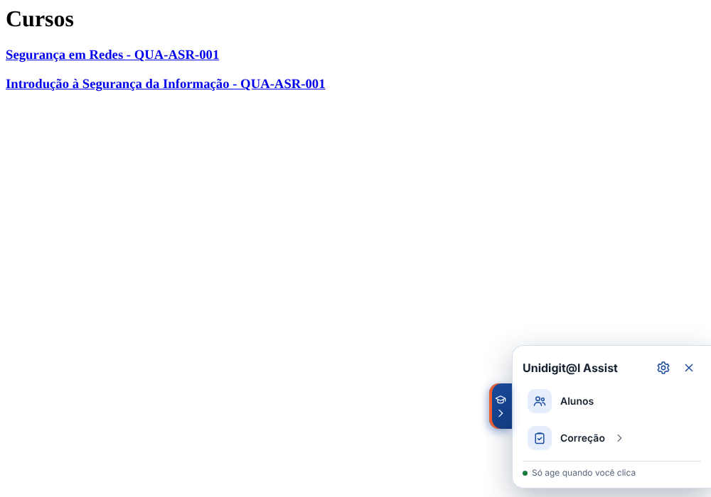
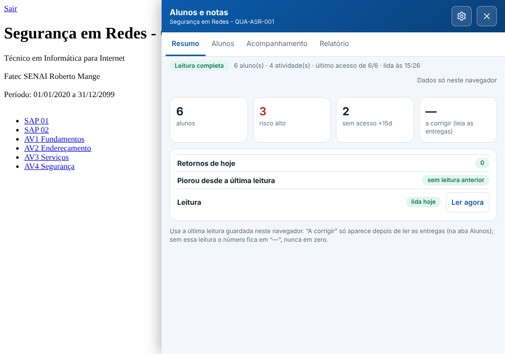
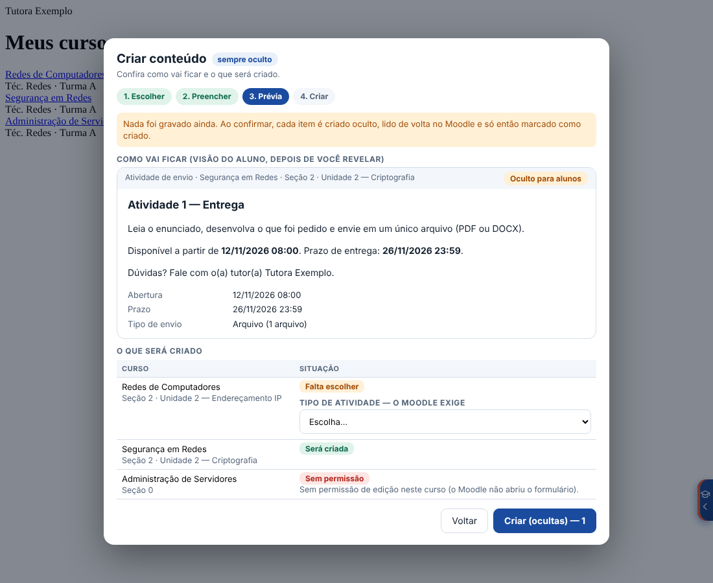
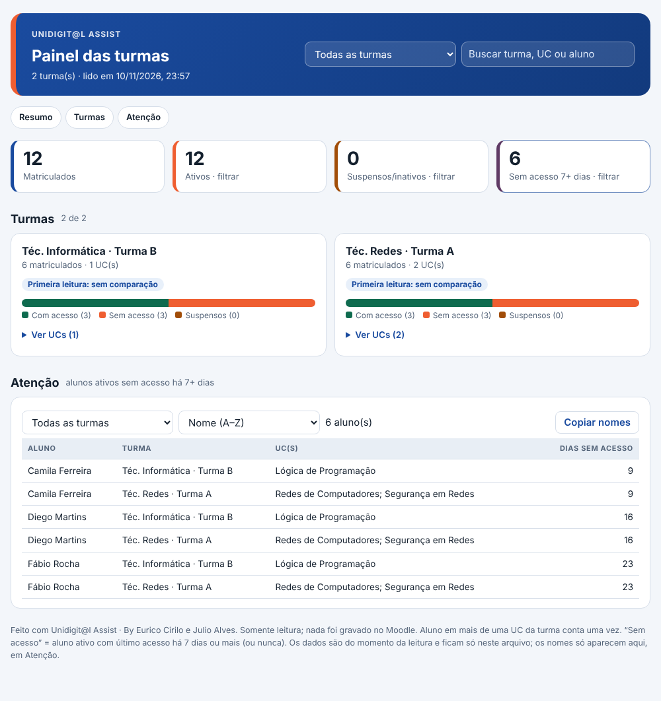

# Unidigit@l Assist

[](https://github.com/euriconetoia-cmyk/Unidigit-l-Assist/actions/workflows/ci.yml)
[](https://github.com/euriconetoia-cmyk/Unidigit-l-Assist/releases)
[](LICENSE)


Ferramentas do tutor EaD dentro do Moodle: **corrigir, cobrar pendências, acompanhar alunos, criar conteúdo e gerar relatórios** sem sair da tela. É uma extensão do Chrome (Manifest V3) para os ambientes `ead.senai.br` e `ead.fieg.com.br`.

> **Nada roda sozinho.** Cada ferramenta só age quando você clica, e nada é gravado no Moodle sem a sua confirmação. Os dados dos alunos não saem do seu navegador.

<p align="center">
  
  
</p>

## O que faz

O menu mostra só o que serve para a página em que você está (no máximo 4 entradas); o apoio (compatibilidade, meus dados, sobre) fica atrás da engrenagem ⚙.

| Ferramenta | Onde funciona | O que entrega |
|---|---|---|
| **Alunos** | Curso | Resumo do dia, lista e boletim com filtros, **acompanhamento** de alunos em risco com mensagem revisada antes de enviar, **relatório da UC** (HTML, Excel, CSV e PDF) e leitura que pode ser continuada se falhar. |
| **Correção** | Curso, categoria e atividade | Radar de **pendências** por atividade e lançamento de notas e feedback por CSV/XLSX, com régua de nota, prévia, confirmação e conferência depois de salvar. |
| **Criar conteúdo** *(teste)* | Curso | Cria fórum de apresentação, atividade de envio e texto de boas-vindas em vários cursos, com a **seção escolhida pelo nome**, modelo em HTML ou **DOCX**, prévia e tudo criado **oculto** e conferido. |
| **Datas** | Curso | **Conferir datas** do cronograma contra as atividades e **Cronograma da turma** (importa o JSON do Cronograma EaD e prepara a atualização só das datas). |
| **Turma** | Meus cursos | Relatório da turma com matriculados, ativos, suspensos e sem acesso, em **painel HTML** (arquivo único, abre offline) e/ou Excel. |

<p align="center">
  
  
</p>

> As telas acima usam **dados fictícios**.

## Instalar

1. ⭐ **Aperte na estrelinha** no topo desta página (botão *Star*). É de graça, leva 5 segundos e ajuda quem desenvolve a continuar.
2. Baixe o ZIP da versão mais recente em **[Releases](https://github.com/euriconetoia-cmyk/Unidigit-l-Assist/releases/latest)** e extraia.
3. No Chrome, abra `chrome://extensions`, ligue o **Modo do desenvolvedor** e clique em **Carregar sem compactação**, escolhendo a pasta extraída.
4. Abra uma página do Moodle: a aba do Unidigit@l Assist aparece na borda direita (atalho **Alt+U**).

Se a extensão **Importar Notas** original estiver ativa, desative-a: as duas desenhariam a mesma barra.

## Desenvolver

Requisitos: Node 20 ou mais novo.

```bash
npm ci
npm run build       # monta a extensão em dist/ext
npm test            # testes unitários (node:test + jsdom)
npm run validate    # manifesto, permissões e arquivos
npm run package     # gera dist/<nome>-<versão>.zip
npm run test:e2e    # Chromium real + Moodle simulado (precisa de Playwright global)
```

- `npm run sync` atualiza a cópia do código dos projetos de origem (Importar Notas e Assistente EaD) em `vendor/`; só é preciso quando esses projetos mudam, e eles devem estar em pastas ao lado deste.
- Estrutura e decisões: [`docs/contexto/`](docs/contexto) (produto, arquitetura, regras, design, tarefas e histórico de decisões).
- Fluxo de contribuição: [`CONTRIBUTING.md`](.github/CONTRIBUTING.md), [Código de conduta](.github/CODE_OF_CONDUCT.md) e [GitHub e releases](docs/projeto/GITHUB.md). Histórico de versões: [`CHANGELOG.md`](CHANGELOG.md).

## Estrutura do repositório

```
src/            código da extensão (launcher, módulos Importar Notas e Alunos, painel de blocos opcional)
tests/          testes unitários e e2e (Chromium + Moodle simulado)
scripts/        build, validação, empacotamento, sincronização e configuração do GitHub
docs/           contexto do projeto, mockups, imagens do README, créditos/privacidade e histórico (veja docs/README.md)
icons/          ícones da extensão
.github/        CI, release, templates, CONTRIBUTING e SECURITY
```

## Segurança e privacidade

- Permissões mínimas: `scripting`, `storage`, `downloads` e os dois domínios do Moodle (mais, **opcional e só se você aceitar**, `create.kahoot.it` para importar perguntas no Kahoot). Nenhum serviço externo, nenhum script remoto.
- Dados de alunos ficam no navegador; relatórios exportados são arquivos locais. Veja [`PRIVACIDADE.md`](docs/projeto/PRIVACIDADE.md) e [`SECURITY.md`](.github/SECURITY.md).
- **Estado de homologação:** testado em páginas simuladas; a validação no Moodle real do SENAI/FIEG é feita por versão e registrada no `CHANGELOG`.

## Créditos e licença

Idealização e desenvolvimento: **Eurico Cirilo**. Coautor: **Julio Alves** (Importador de Notas 0.8.1 e ideias do projeto *SENAI Extensões*: Excel, relatório por turma e Kahoot). Detalhes em [`CREDITOS.md`](docs/projeto/CREDITOS.md).

Licença [MIT](LICENSE) — © 2026 Eurico Cirilo e Julio Alves. Uso, cópia e modificação livres, mantendo o aviso de copyright.
